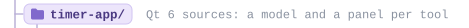

# ⏱ Timer Application

This project is a cross-platform desktop application developed using **C++** and **Qt6**, providing functionality for three core timekeeping tools:
- **Timer** – counts down from a given time.
- **Stopwatch** – measures elapsed time with split functionality.
- **Alarm** – alerts the user at a set time.

## 🗂 Project Structure


<!-- project-tree:start -->
<p>
<a href="https://github.com/LazarDavidovic98/timer-app" title="timer-app"></a><br>
<a href="https://github.com/LazarDavidovic98/timer-app/blob/main/timer-app.sln" title="timer-app.sln"></a><br>
<a href="https://github.com/LazarDavidovic98/timer-app/tree/main/timer-app" title="timer-app/"></a><br>
<a href="https://github.com/LazarDavidovic98/timer-app/blob/main/timer-app/main.cpp" title="timer-app/main.cpp"></a><br>
<a href="https://github.com/LazarDavidovic98/timer-app/blob/main/timer-app/MainWindow.cpp" title="timer-app/MainWindow.cpp"></a><br>
<a href="https://github.com/LazarDavidovic98/timer-app/blob/main/timer-app/TimerModel.cpp" title="timer-app/TimerModel.cpp"></a><br>
<a href="https://github.com/LazarDavidovic98/timer-app/blob/main/timer-app/TimerPanel.cpp" title="timer-app/TimerPanel.cpp"></a><br>
<a href="https://github.com/LazarDavidovic98/timer-app/blob/main/timer-app/StopWatchModel.cpp" title="timer-app/StopWatchModel.cpp"></a><br>
<a href="https://github.com/LazarDavidovic98/timer-app/blob/main/timer-app/StopWatchPanel.cpp" title="timer-app/StopWatchPanel.cpp"></a><br>
<a href="https://github.com/LazarDavidovic98/timer-app/blob/main/timer-app/SplitPanel.cpp" title="timer-app/SplitPanel.cpp"></a><br>
<a href="https://github.com/LazarDavidovic98/timer-app/blob/main/timer-app/AlarmModel.cpp" title="timer-app/AlarmModel.cpp"></a><br>
<a href="https://github.com/LazarDavidovic98/timer-app/blob/main/timer-app/AlarmPanel.cpp" title="timer-app/AlarmPanel.cpp"></a><br>
<a href="https://github.com/LazarDavidovic98/timer-app/blob/main/timer-app/SoundEngine.cpp" title="timer-app/SoundEngine.cpp"></a><br>
<a href="https://github.com/LazarDavidovic98/timer-app/blob/main/timer-app/timer_model_test.cpp" title="timer-app/timer_model_test.cpp"></a><br>
<a href="https://github.com/LazarDavidovic98/timer-app/blob/main/timer-app/timer-app.vcxproj" title="timer-app/timer-app.vcxproj"></a><br>
<a href="https://github.com/LazarDavidovic98/timer-app/tree/main/timer-app/resources" title="timer-app/resources/"></a><br>
<a href="https://github.com/LazarDavidovic98/timer-app/blob/main/docs/Documentation.md" title="docs/Documentation.md"></a><br>
</p>

<sub>Every row is a link to that file or folder on GitHub. Purple: folders, green: source code, grey: configuration, data and docs.</sub>
<!-- project-tree:end -->

## How to Build

### Requirements
- **Qt 6.x** (e.g. 6.6.3) with `mingw_64` or MSVC toolchain
- **CMake >= 3.14**
- **Visual Studio 2022** or **Visual Studio Code**
- Compiler: MinGW or MSVC

### Build with CMake
```bash
mkdir build
cd build
cmake .. -DCMAKE_PREFIX_PATH="C:/Qt/6.6.3/mingw_64"
cmake --build .
```

### Run
```bash
./TimeApp.exe
```

## Features

-  Start, Stop, Reset for Timer and Stopwatch
-  Alarm scheduling with toggle
-  Display of time splits for Stopwatch
-  Resource loading via `.qrc` file (icons, sounds)
-  Modular architecture

## Notes

- Font rendering warnings (e.g., `CreateFontFaceFromHDC()`) may occur on Windows. They do not impact functionality.
- If using Visual Studio, make sure the `.qrc` file is set to `Qt Resource File` in properties.

---

**Detailed documentation is available here**: [Documentation](docs/Documentation.md)

Developed as an educational project to explore GUI development in C++ using Qt.
